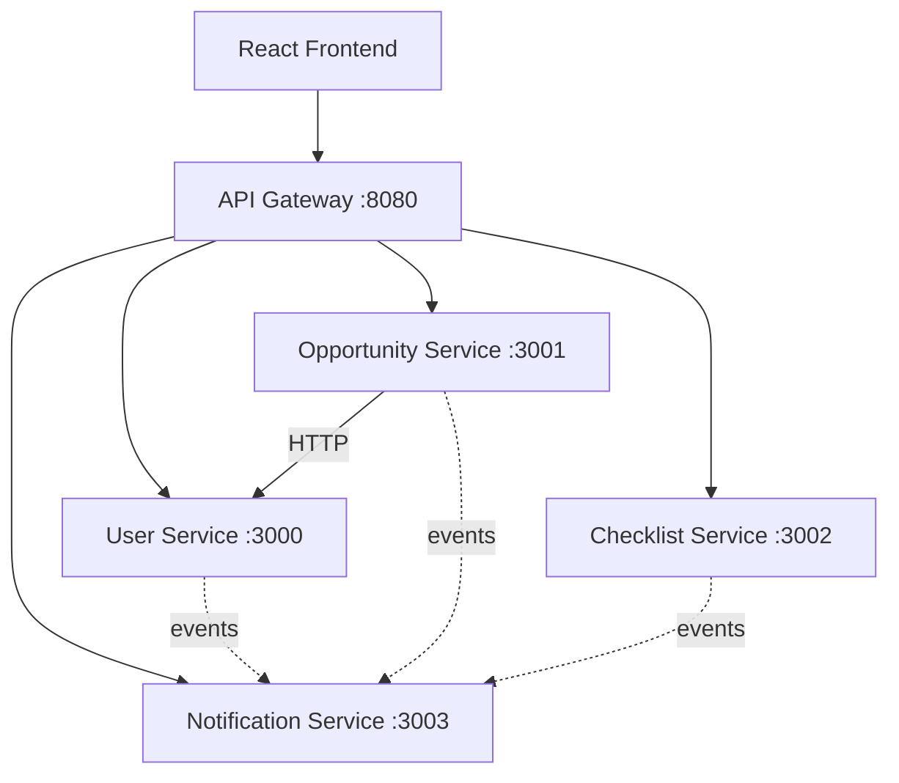

# NewStart

**NewStart** is a small, production-style microservices application that helps newcomers
relocating to Western countries **organize relocation tasks** and **discover relevant
employment and community opportunities**.

It is intentionally simple in features. The goal is a clean, containerizable application
that can be used to practice Docker, Kubernetes, networking, service discovery, Helm, EKS,
Terraform, CI/CD, observability, scaling, reliability and security — while remaining
**simple enough for one developer to understand completely**.

> This repository is the **application layer only**. Cloud/Kubernetes/Terraform/CI-CD/
> observability infrastructure is deliberately **out of scope**.

> 👉 **New here?** Start with the friendly walkthrough in **[`docs/GUIDE.md`](docs/GUIDE.md)** —
> it explains what the app is and how to run it locally, step by step.

---

## Table of contents

1. [What NewStart does](#1-what-newstart-does)
2. [Architecture](#2-architecture)
3. [Microservice responsibilities](#3-microservice-responsibilities)
4. [API endpoints](#4-api-endpoints)
5. [Database design](#5-database-design)
6. [Service-to-service communication](#6-service-to-service-communication)
7. [Local development](#7-local-development)
8. [Testing](#8-testing)
9. [Docker usage](#9-docker-usage)
10. [Environment variables](#10-environment-variables)
11. [Future Kubernetes deployment considerations](#11-future-kubernetes-deployment-considerations)

---

## 1. What NewStart does

Users can:

1. Create a profile.
2. Specify their skills and preferred location.
3. Browse relevant opportunities (jobs, training, community programs, events, resources).
4. Save opportunities.
5. Create and manage relocation tasks (a checklist).
6. Receive notifications about important events.

General relocation guidance only — **not legal or immigration advice**.

## 2. Architecture

Four backend microservices behind a thin API gateway, a React frontend, and PostgreSQL
(one database per service). Full detail and diagrams in
[`docs/architecture.md`](docs/architecture.md).



## 3. Microservice responsibilities

| Service              | Port | Owns database            | Responsibility |
| -------------------- | ---- | ------------------------ | -------------- |
| User Service         | 3000 | `newstart_users`         | Profiles, skills, preferences |
| Opportunity Service  | 3001 | `newstart_opportunities` | Opportunities, filtering, matching, recommendations |
| Checklist Service    | 3002 | `newstart_checklists`    | Relocation checklists & tasks |
| Notification Service | 3003 | `newstart_notifications` | Event ingestion, worker processing, notifications |

## 4. API endpoints

Each service serves interactive OpenAPI docs at `/api-docs` and a machine-readable spec at
`/api-docs.json`. Summary (see [`docs/api-contracts.md`](docs/api-contracts.md) for the
full contract):

**User Service**

```http
POST   /api/v1/users
GET    /api/v1/users/:id
PUT    /api/v1/users/:id
DELETE /api/v1/users/:id
GET    /api/v1/users/:id/skills
PUT    /api/v1/users/:id/skills
```

**Opportunity Service**

```http
POST   /api/v1/opportunities
GET    /api/v1/opportunities            # ?location=&skill=&type=&remote=&page=&limit=
GET    /api/v1/opportunities/:id
PUT    /api/v1/opportunities/:id
DELETE /api/v1/opportunities/:id
GET    /api/v1/opportunities/recommended/:userId
POST   /api/v1/opportunities/:id/save          # emits OPPORTUNITY_SAVED
DELETE /api/v1/opportunities/:id/save/:userId
GET    /api/v1/saved/:userId
```

**Checklist Service**

```http
POST   /api/v1/checklists
GET    /api/v1/checklists/:userId       # ?status=&category=&sort=&page=&limit=
POST   /api/v1/checklists/:userId/tasks
PATCH  /api/v1/tasks/:taskId
DELETE /api/v1/tasks/:taskId
```

**Notification Service**

```http
POST   /internal/events                 # event ingest (service-to-service)
GET    /api/v1/notifications/:userId
```

Every service also exposes `GET /health` and `GET /ready`.

## 5. Database design

PostgreSQL, one database per service, schema created and versioned via migrations
(`node-pg-migrate`). Each service can initialize a fresh database with `npm run migrate:up`.
Controllers never run SQL directly; a repository layer uses parameterized queries only.

## 6. Service-to-service communication

- **Synchronous:** Opportunity Service → User Service over HTTP to read a user's skills for
  recommendations. Service URLs come from environment variables (never hard-coded).
- **Asynchronous:** state-changing actions publish events through the `MessagePublisher`
  interface. The local implementation posts to the Notification Service, which enqueues to
  a Postgres queue and processes with a replica-safe worker. See
  [`docs/architecture.md`](docs/architecture.md) for the event model and idempotency design.

## 7. Local development

Prerequisites: Node 20+ (22 recommended) and Docker.

```bash
# 1. Install all workspace dependencies
npm install

# 2. Copy environment defaults
cp .env.example .env

# 3. Start everything (frontend, 4 services, gateway, Postgres)
docker compose up --build
```

Then open:

- Frontend: http://localhost:5173
- API Gateway: http://localhost:8080
- Per-service OpenAPI docs: e.g. http://localhost:3000/api-docs (and `/api-docs.json`)

Each backend service runs its own migrations on startup, so the databases are created
and initialized automatically.

To run a single service without Docker: start a local PostgreSQL, copy the service's
`.env.example` to `.env`, then from the repo root:

```bash
npm install
npm run build:packages
npm run migrate:up --workspace=services/user-service   # once, to initialize the schema
npm run dev --workspace=services/user-service
```

## 8. Testing

Vitest (unit) + Supertest (integration/API). Run everything:

```bash
npm test
```

Or per service: `npm test --workspace=services/user-service`.

Integration tests run against an **in-memory PostgreSQL** (`pg-mem`) using each service's
canonical `schema.sql`, so the full API + repository + SQL path is exercised with **no
external database required** — `npm test` is green anywhere. The same `schema.sql` is what
the production migration applies, so the tested schema cannot drift from the deployed one.

## 9. Docker usage

Every backend service and the frontend has a production-quality multi-stage Dockerfile
(small runtime image, non-root user, production dependencies only, proper signal handling,
no secrets baked in). `docker-compose.yml` wires them together with PostgreSQL for local
development. **No Kubernetes manifests or Helm charts are included** — that is the platform
owner's responsibility.

## 10. Environment variables

All configuration is environment-based. See [`.env.example`](.env.example) and each
service's `.env.example`. Key variables:

| Variable | Purpose |
| -------- | ------- |
| `*_SERVICE_URL` | Service discovery URLs (compose/K8s service names) |
| `DATABASE_URL` | Per-service Postgres connection string |
| `VITE_API_BASE_URL` | Single API base URL for the frontend |
| `LOG_LEVEL` | Log verbosity |
| `CORS_ALLOWED_ORIGINS` | Comma-separated CORS allow-list |

## 11. Future Kubernetes deployment considerations

The application is written to drop into Kubernetes later:

- **Stateless & horizontally scalable** — no in-memory sessions, no local disk state.
- **Health probes** — `/health` and `/ready` map to liveness/readiness/startup probes.
- **Graceful shutdown** — SIGTERM/SIGINT handled (drain, close DB, stop workers).
- **Config via env** — inject via ConfigMaps/Secrets; service URLs map to Service DNS.
- **Replica-safe worker** — the notification worker uses `SKIP LOCKED` + idempotency.
- **Swappable seams** — `MessagePublisher`/`MessageConsumer`/`NotificationProvider` and the
  `AuthProvider` interface are where SQS/SNS/SES and Cognito/OIDC plug in.
- **Gateway → Ingress** — the local gateway is replaceable by a K8s Ingress.

---

## Authentication (development only)

A dev-only mock is provided behind an `AuthProvider` interface (`@newstart/shared-utils`).
The frontend's Demo Login creates/selects a user and sends `Authorization: Bearer dev:<id>`;
services attach the identity to each request (non-enforcing by default; `requireAuth()`
protects any route). **No passwords, no signature verification — not for production.** It is
designed to be swapped for AWS Cognito / OIDC without touching controllers or pages.

## Project status

All eleven phases are complete: four backend services, API gateway, React frontend,
PostgreSQL per service with migrations, OpenAPI docs, structured logging, health/readiness
probes, graceful shutdown, an idempotent replica-safe notification worker, Docker + Docker
Compose, and a 91-test suite (unit + integration). Verified end-to-end under Docker Compose.

## License

For learning/practice use.
