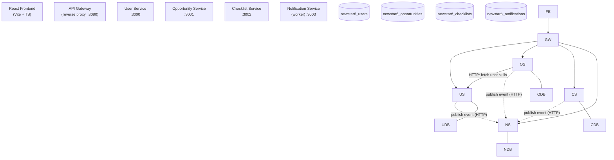
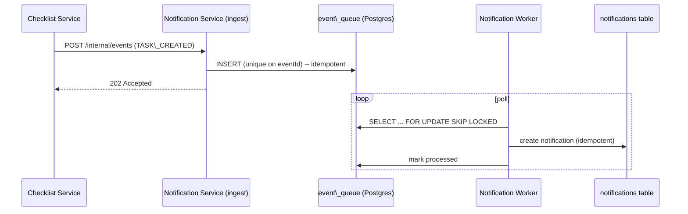

# NewStart — Architecture

NewStart is a small, production-style microservices application that helps newcomers
relocating to Western countries organize relocation tasks and discover relevant
opportunities. It is intentionally simple in features but structured so it can later be
containerized and deployed to Kubernetes.

> \*\*Scope boundary:\*\* This repository contains \*\*only the application layer\*\*
> (services, frontend, Dockerfiles, local Docker Compose). Cloud/Kubernetes/Terraform/
> CI-CD/observability infrastructure is intentionally \*\*out of scope\*\* and owned by the
> platform operator.

## System overview



Legend: solid arrows are synchronous request/response; dotted arrows are asynchronous
event publications (fire-and-forget from the caller's perspective).

## Services

|Service|Port|Database|Responsibility|
|-|-|-|-|
|User Service|3000|`newstart\_users`|User profiles \& skills/preferences|
|Opportunity Service|3001|`newstart\_opportunities`|Opportunities, filtering, matching/recommendations|
|Checklist Service|3002|`newstart\_checklists`|Relocation checklists \& tasks|
|Notification Service|3003|`newstart\_notifications`|Event ingestion, worker processing, notifications|
|API Gateway|8080|—|Single entry point / reverse proxy for the frontend|

The **API Gateway is not one of the four business microservices** — it is thin routing
infrastructure so the frontend can use a single configurable base URL. In Kubernetes it
would be replaced by an Ingress; it holds no business logic and no database.

## Layered design (per service)

```text
HTTP request
    │
    ▼
Controller (Express handler)   ── validates via Zod, maps to/from DTOs
    │
    ▼
Service (business logic)       ── matching, status transitions, orchestration
    │
    ▼
Repository (data access)       ── parameterized SQL only
    │
    ▼
PostgreSQL (owned by service)
```

Controllers never execute SQL directly. Each service owns its database and is the only
component allowed to read/write it. Cross-service data is fetched over HTTP.

## Data ownership

Each service owns a **separate PostgreSQL database**. No service connects to another
service's database. When the Opportunity Service needs a user's skills to compute
recommendations, it calls the User Service's HTTP API (`GET /api/v1/users/:id/skills`).

## Eventing \& the Notification worker

The application defines a reusable event contract (`packages/shared-events`) and three
abstractions so cloud messaging can be swapped in later without touching business logic:

* `MessagePublisher` — publish an event. Local implementation posts the event over HTTP
to the Notification Service's internal ingest endpoint (fire-and-forget; a failure to
publish never fails the originating user request). Production implementation → AWS SQS.
* `MessageConsumer` — pull and process events. Local implementation polls a Postgres
`event\_queue` table using `SELECT … FOR UPDATE SKIP LOCKED`, which lets **multiple
worker replicas run safely** without processing the same event twice. Production → SQS.
* `NotificationProvider` — deliver a notification. Local implementation logs to stdout
(structured JSON) and persists to the `notifications` table. Production → SES/SNS/etc.



**Idempotency:** events carry a unique `eventId`. Ingest de-duplicates on insert, and the
worker records processed events, so at-least-once delivery and duplicate processing are
handled safely — important because Kubernetes may run multiple replicas.

### Event types

`TASK\_CREATED`, `TASK\_DUE\_SOON`, `TASK\_COMPLETED`, `OPPORTUNITY\_SAVED`, `NEW\_RECOMMENDATION`.

### Event envelope

```json
{
  "eventId": "uuid",
  "eventType": "TASK\_COMPLETED",
  "timestamp": "2026-08-16T12:00:00Z",
  "source": "checklist-service",
  "data": { "taskId": "123", "userId": "456" }
}
```

## Matching algorithm (deterministic, no AI)

Given a user's skills and an opportunity's required skills:

```text
match score = (matching skills / required skills) \* 100   (rounded)
```

Case-insensitive set intersection. If an opportunity requires no skills, it is treated as
a 100% match. Recommendations are the opportunities sorted by descending score.

## Cross-cutting concerns

* **Config:** every service reads configuration from environment variables only. No
hard-coded hostnames; service URLs are injected (`USER\_SERVICE\_URL`, etc.).
* **Logging:** structured JSON to stdout/stderr (Pino). Every request gets a
correlation/request ID (`x-request-id`, generated if absent) that is logged and echoed.
* **Errors:** consistent envelope `{ "error": { code, message, requestId } }`; no stack
traces leaked to clients.
* **Health:** `/health` (liveness — process is up) and `/ready` (readiness — dependencies
such as the database are reachable). Designed for K8s liveness/readiness/startup probes.
* **Graceful shutdown:** on `SIGTERM`/`SIGINT` each service stops accepting new
connections, drains in-flight requests, stops workers, and closes the DB pool.
* **Security:** Helmet headers, CORS allow-list, request body size limits, rate-limit
abstraction, parameterized queries, input validation, no secrets in source.
* **Statelessness:** no in-memory sessions, no local filesystem persistence; all state is
in Postgres, so services scale horizontally.

## Authentication (development abstraction)

A dev-only mock authentication mechanism is provided behind an `AuthProvider` interface so
it can later be replaced by AWS Cognito / OIDC. The application does not depend on Cognito.
The frontend uses a "Demo Login" that selects/creates a user; the gateway/services accept a
bearer identity header. **This is clearly development-only and not production auth.**

## Deployment notes (for the platform owner)

* Each service is independently deployable and independently testable.
* Services are stateless and horizontally scalable; the notification worker is
replica-safe.
* Health endpoints map directly to K8s `livenessProbe` / `readinessProbe` / `startupProbe`.
* The `MessagePublisher`/`MessageConsumer`/`NotificationProvider` interfaces are the seams
where AWS SQS/SNS/SES implementations plug in later.
* The gateway maps to an Ingress; per-service `\*\_SERVICE\_URL` env vars map to K8s Service
DNS names.

